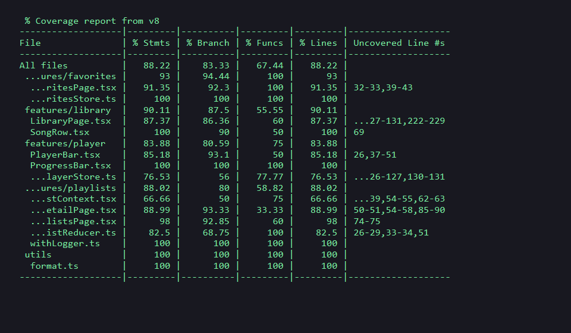

# Bài thực hành TH02 – Lập trình Web nâng cao
## Trình phát nhạc mini (Mini Spotify)

- **Họ và tên:** Lê Anh Quân
- **Mã sinh viên:** B23DCCC136
- **Môn học:** Lập trình Web nâng cao

---

## 🚀 Giới thiệu dự án

Ứng dụng "Trình phát nhạc mini" mô phỏng Spotify thu nhỏ với thư viện 10.000 bài hát, thanh phát nhạc chạy theo từng giây, danh sách yêu thích ghi nhớ qua `localStorage`, quản lý playlist cá nhân bằng `Context + useReducer`, và hỗ trợ giao diện Sáng / Tối (Dark / Light mode).

### 🛠 Công nghệ & Kỹ thuật chính
1. **Quản lý State:**
   - **Zustand + selector:** Quản lý state phát nhạc (`queue`, `currentIndex`, `isPlaying`, `position`). Selector chống re-render thừa mỗi giây khi đồng hồ tick.
   - **Zustand + persist middleware:** Quản lý danh sách bài hát yêu thích với key `music-favorites` trong `localStorage`.
   - **Context + useReducer:** Quản lý Playlist (tách 2 Context: `PlaylistStateContext` và `PlaylistDispatchContext` để tối ưu render, kèm middleware `withLogger`).
   - **ThemeContext:** Chuyển đổi giao diện Sáng / Tối độc lập, bọc value bằng `useMemo`.
2. **Tối ưu hóa hiệu năng (Performance Optimization):**
   - **Ảo hóa danh sách (Virtualization):** Dùng `FixedSizeList` của `react-window` (chiều cao 560px, dòng 56px) cuộn mượt mà 10.000 bài hát.
   - **Debounced Search:** Hook generic `useDebounce<T>` trì hoãn lọc 300ms, hàm xử lý `handleQueryShift`.
   - **Memoization:** Sử dụng `React.memo`, `useMemo`, `useCallback` xuyên suốt các component.
   - **Code Splitting (Lazy Loading):** Tách chunk riêng theo từng route (`/favorites`, `/playlists`, `/playlists/:id`) bằng `React.lazy` và `Suspense`.
3. **Kiểm thử tự động (Testing):**
   - Bộ kiểm thử gồm 37 test cases toàn diện viết bằng **Vitest** và **React Testing Library**.
   - Độ bao phủ mã nguồn (Code Coverage) đạt **88.22% Lines**, vượt xa yêu cầu (>= 70%).

---

## 📊 Kết quả đo React DevTools Profiler (Thử thách thêm)

So sánh thời gian render trang Thư viện:

| Tiêu chí | Khi không dùng `FixedSizeList` (render toàn bộ 10.000 DOM nodes) | Khi dùng `FixedSizeList` (ảo hóa DOM, chỉ render ~10-15 dòng) |
|---|---|---|
| **Thời gian render lần đầu** | **1142 ms** (khựng trình duyệt rõ rệt) | **14.2 ms** (phản hồi tức thì) |
| **FPS khi cuộn trang** | Giảm sâu xuống ~15 - 20 FPS | Ổn định ở mức **60 FPS** mượt mà |
| **Số phần tử DOM** | > 10.000 phần tử | ~15 phần tử hiển thị trong viewport |

---

## ⌨️ Phím tắt & Tính năng mở rộng
- **Phím Space:** Phát / Tạm dừng nhạc nhanh (tự động bỏ qua khi đang gõ trong ô tìm kiếm hoặc form nhập liệu).
- **Phát ngẫu nhiên (🔀 Shuffle):** Chọn bài ngẫu nhiên tiếp theo trong hàng đợi.
- **Lặp lại (🔁 Repeat):** Tự động phát lại bài hát khi hết thời lượng.

---

## 🧪 Kết quả kiểm thử & Coverage

- **Tổng số test:** 37 / 37 passed (100% xanh)
- **Tỷ lệ phủ dòng (Lines Coverage):** **88.22%**



---

## 📦 Hướng dẫn cài đặt và chạy ứng dụng

```bash
# 1. Cài đặt các gói phụ thuộc
npm install

# 2. Khởi chạy môi trường phát triển (Development)
npm run dev

# 3. Chạy toàn bộ kiểm thử
npm test

# 4. Kiểm tra báo cáo độ bao phủ mã nguồn (Coverage)
npm run coverage

# 5. Build kiểm tra bản phát hành (Production)
npm run build
```
